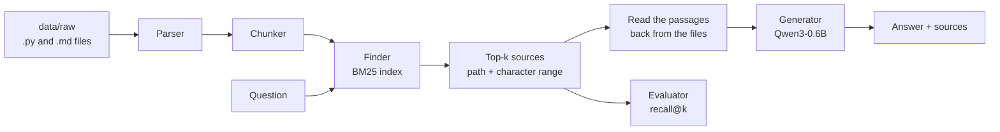

*This project has been created as part of the 42 curriculum by jtardieu*
### Aikueika
# RAG again the machine


<table>
  <tr>
    <td>
      
    </td>
    <td align="center">
      <h2>Will you answer my questions?</h2>
    </td>
	<td>
      
    </td>
  </tr>
</table>

## Description

**Aikueika** is a Retrieval-Augmented Generation (RAG) system that answers
questions about the [vLLM](https://github.com/vllm-project/vllm) 0.10.1
repository (its documentation and its Python code).

A small language model only knows what it was trained on, and retraining it
to add knowledge is slow and expensive. A RAG system does the opposite: it
keeps the knowledge outside the model, **finds** the passages of the corpus
that matter for a question, and **hands them to the model** so that it can
answer from them.

The pipeline does four things:

1. **Index**: split the corpus (`.py` and `.md` files) into chunks of at most
   2000 characters and index them with BM25.
2. **Search**: for a question, return the top-*k* sources as
   `(file_path, first_character_index, last_character_index)`.
3. **Answer**: give the best passages to `Qwen/Qwen3-0.6B` and generate an
   answer grounded in them.
4. **Evaluate**: measure retrieval quality with recall@*k*.

Everything runs on CPU, from a single command-line tool.

## Instructions

### Requirements

- Python 3.13 and [`uv`](https://docs.astral.sh/uv/)
- The vLLM 0.10.1 sources in `data/raw/vllm-0.10.1/`
- The question datasets in `data/datasets/AnsweredQuestions/` and
  `data/datasets/UnansweredQuestions/`

The `data/` folder is not versioned (it is in `.gitignore`).

### Installation

```bash
make install        # uv sync
```

### Makefile rules

| Rule | What it does |
|---|---|
| `make install` | Install the dependencies with `uv sync` |
| `make run` | Run the project |
| `make debug` | Run the project in debug mode |
| `make clean` | Remove caches and temporary files |
| `make lint` | `flake8` + `mypy` with the required flags |
| `make lint-strict` | `flake8` + `mypy --strict` |
| `make index` | Build the index |
| `make search` | Search a single question |
| `make search_dataset` | Search every question of a dataset |
| `make answer` | Answer a single question |
| `make answer_dataset` | Answer every question of a search results file |
| `make evaluate` | Compute recall@k with our own code |
| `make score` | Compute recall@k with the official moulinette |

The data rules take variables: `K`, `CHUNK`, `QUERY`, `SCOPE`
(`UnansweredQuestions` or `AnsweredQuestions`) and `NAME` (`docs` or `code`),
for example `make search_dataset NAME=code K=10`.

## Example usage

All commands go through one entry point, built with
[Python Fire](https://github.com/google/python-fire):

```bash
uv run python -m src <command> [options]
```

| Command | Options | Role |
|---|---|---|
| `index` | `--max_chunk_size` (default 2000) | Parse the corpus, chunk it, build the index |
| `search "<question>"` | `--k` (default 5) | Print the top-k sources of one question |
| `search_dataset` | `--dataset_path`, `--k`, `--save_directory` | Search a whole dataset, save a JSON file |
| `answer "<question>"` | `--k` | Print the sources and the generated answer |
| `answer_dataset` | `--student_search_results_path`, `--save_directory` | Generate answers from a search results file |
| `evaluate` | `--student_search_results_path`, `--dataset_path` | Print recall@k |

Search one question:

```bash
uv run python -m src search "How to configure the OpenAI server?" --k 5
```

Full workflow on the docs dataset:

```bash
uv run python -m src index --max_chunk_size 2000

uv run python -m src search_dataset \
  --dataset_path data/datasets/UnansweredQuestions/dataset_docs_public.json \
  --k 10 \
  --save_directory data/output/search_results/UnansweredQuestions

uv run python -m src evaluate \
  --student_search_results_path data/output/search_results/UnansweredQuestions/dataset_docs_public.json \
  --dataset_path data/datasets/AnsweredQuestions/dataset_docs_public.json

uv run python -m src answer_dataset \
  --student_search_results_path data/output/search_results/UnansweredQuestions/dataset_docs_public.json \
  --save_directory data/output/search_results_and_answer/UnansweredQuestions
```

Output of `evaluate`:

```text
Student data is valid: True
Evaluation Results
========================================
Recall@1: 0.570 Recall@3: 0.750 Recall@5: 0.810 Recall@10: 0.870
Questions: 100, without results: 0, sources too long: 0
```

The command-line tool never crashes on bad input: an empty query, `k=0` or a
non-integer `k`, a missing file or an invalid JSON file all produce a one-line
error message on `stderr`, never a traceback.

## System architecture



Each component lives in `src/` and does one job:

| File | Component | Role |
|---|---|---|
| `pars_content.py` | `Parser` | Find the `.py` and `.md` files and read them (`SourceFile` models) |
| `chunker.py` | `Chunker` | Split a file into chunks of at most `max_chunk_size` characters |
| `finder.py` | `Finder` | Build the BM25 index and return the best chunks for a query |
| `generator.py` | `Generator` | Load Qwen3-0.6B (lazily) and generate an answer from passages |
| `pipeline.py` | `Pipeline` | Chain the steps: index, search, answer, and dataset processing |
| `evaluator.py` | `Evaluator` | Compute recall@k against a ground-truth dataset |
| `models.py` | pydantic models | `MinimalSource`, `StudentSearchResults`, `StudentSearchResultsAndAnswer`, ... |
| `__main__.py` | `Cli` | The Fire commands; catches errors and prints clean messages |

`Pipeline` does the work and raises `OSError` or `ValueError`; `Cli` is a thin
layer that reports them. This keeps the logic reusable (tests, other
front-ends) and the command-line tool robust.

## Chunking strategy

Only `.py` and `.md` files are indexed. Every chunk keeps the character range
`[start, end)` it covers in the **original** file, because the retrieval
result is a range of characters, not a text. The maximum size is
`--max_chunk_size` (default **2000**): the moulinette rejects any source longer
than 2000 characters, so a single longer chunk would invalidate a whole output.

The same greedy algorithm is used for both file types, with different
*preferred cut points* (boundaries):

- **Python**: the file is parsed with the standard `ast` module and the end of
  every top-level definition (function, class, statement) is a boundary. A
  file that cannot be parsed falls back to line boundaries, so it is still
  indexed.
- **Markdown**: the end of every blank line (a paragraph break) is a boundary.

Starting from the beginning of the file, the chunker takes the **farthest
boundary that fits** in the size limit, so it packs as many whole definitions
or paragraphs as possible. If there is no boundary in range, it cuts at the
last line break, and as a last resort exactly at the limit. Chunks that contain
only whitespace are dropped.

## Retrieval method

The retriever is **BM25** (`BM25Okapi` from the
[`rank-bm25`](https://github.com/dorianbrown/rank_bm25) library, default
parameters). BM25 scores a chunk by how often the query words appear in it,
giving more weight to rare words and correcting for the length of the chunk.

- **Tokenization**: lowercase, then `\w+` word extraction, applied to the
  chunks and to the query.
- **Ranking**: every chunk is scored, scores are sorted in decreasing order and
  the first *k* chunks are returned.
- **Output**: each chunk becomes a `MinimalSource` with the file path
  (relative to the project root, e.g. `data/raw/vllm-0.10.1/docs/...`) and the
  first and last character indices.

BM25 is purely lexical, which suits this corpus well: questions often contain
the exact names that appear in the docs and the code.

## Answer generation

- **Model**: `Qwen/Qwen3-0.6B` with `transformers`, in `float32` on CPU,
  loaded only when the first answer is needed (so `index` and `search` never
  pay the loading time).
- **Context**: the answer command and `answer_dataset` re-read the text of the
  sources from the files, using the character ranges. Only the **first 3
  passages** are given to the model, to stay within its token budget, but all
  *k* sources stay in the output.
- **Prompt**: the system prompt asks the model to use only the given context
  and to say clearly when the context does not contain the answer. Qwen3's
  "thinking" mode is disabled and decoding is greedy, so answers are
  reproducible.
- **No context, no model call**: if no passage can be found, a fixed message is
  returned instead of letting the model invent an answer.

## Performance analysis

### Retrieval quality

Recall@*k* is the share of a question's correct sources that are retrieved in
the top *k*. A correct source counts as found when one retrieved source is in
the same file and overlaps it with an IoU of at least 0.05.

| Dataset | Recall@1 | Recall@3 | Recall@5 | Recall@10 | Required @5 |
|---|---|---|---|---|---|
| Docs | 0.570 | 0.750 | 0.810 | 0.870 | 0.80 |
| Code | XX | XX | XX | XX | 0.50 |

Our own `evaluate` command and the official moulinette are meant to agree; the
moulinette is the reference.

### Speed

| Step | Measured | Limit |
|---|---|---|
| Indexing the whole corpus | XX s | 5 min |
| Searching 200 questions | XX s | 90 s |
| Answering one question (CPU) | about 12 to 37 s | none |

Answering is slow because a 0.6B model runs on CPU: reading the prompt costs
a few seconds and each generated token costs about 0.4 s, so the length of the
answer matters more than anything else. Answering a full dataset takes a long
time but finishes.

## Design decisions

- **BM25 instead of embeddings**: no extra model, fast to index, easy to
  explain, and strong on exact names. The documented limit is its lack of
  semantic understanding.
- **Classes for each step** (`Parser`, `Chunker`, `Finder`, `Generator`,
  `Pipeline`, `Evaluator`): each one does one thing and can be reused and
  tested alone.
- **Pydantic models** for every input and output, so that invalid JSON files
  are rejected with a clear message instead of crashing later.
- **Offsets point into the original files**: the retrieval result and the
  passage read back at answer time are the same text.
- **`answer_dataset` starts from a search results file**, like the subject
  describes: it does no search and builds no index, it only reads the sources
  and generates.
- **Lazy model loading**: the model is the slowest thing to load, so only the
  commands that need it load it, and only once.
- **3 passages for the model, all sources in the output**: a trade-off between
  speed and the chance that the model sees the right passage, without
  affecting the recall that is measured.
- **Errors are values, not crashes**: the pipeline raises, the command-line
  tool catches and prints one line.

## Challenges faced

- **Paths that did not match.** The parser first stored paths relative to
  `data/raw`, which gave `vllm-0.10.1/docs/...` instead of
  `data/raw/vllm-0.10.1/docs/...`. The grader compares paths word for word, so
  recall would have been zero and the passages could not be read back.
  *Fix*: store paths relative to the project root.
- **A chunk of 2001 characters.** The moulinette rejected the whole output
  because of one source longer than 2000. The cause was an off-by-one error: the
  end of `str.rfind` is excluded, so searching up to `limit + 1` could return a
  line break at position `limit` and produce a chunk one character too long.
  *Fix*: search up to `limit`. Our `evaluate` command also reports sources that
  are too long.
- **Slow answers on CPU.** With 5 passages the prompt was 1705 to 2548 tokens
  and 3 questions took 105 s. Measuring prompt tokens, generated tokens and time
  showed that the context and the answer length were the two costs.
  *Fix*: 3 passages (1266 to 1668 tokens, 64 s for the same questions) and
  shorter answers.
- **Type checking with untyped libraries.** `mypy --strict` rejects some
  `transformers` calls that have no type hints, while the normal `make lint`
  rejects unused ignore comments. *Fix*: a combined
  `# type: ignore[no-untyped-call, unused-ignore]` that satisfies both.

### Known limitations and ideas

- Tokens like `max_num_seqs` or `OpenAIServingChat` stay in one piece; splitting
  identifiers (snake_case and CamelCase) while keeping the original would help
  code questions.
- A query with no matching word still returns chunks with a score of 0; they
  should be filtered out.
- Hybrid search (BM25 plus embeddings) would add semantic matching.

## Resources

### References

- [vLLM documentation](https://docs.vllm.ai)
- [Lewis et al., *Retrieval-Augmented Generation for Knowledge-Intensive NLP
  Tasks* (2020)](https://arxiv.org/abs/2005.11401)
- Robertson and Zaragoza, *The Probabilistic Relevance Framework: BM25 and
  Beyond* (2009)
- [rank-bm25](https://github.com/dorianbrown/rank_bm25)
- [Qwen3-0.6B model card](https://huggingface.co/Qwen/Qwen3-0.6B) and the
  [Qwen3 Technical Report](https://arxiv.org/abs/2505.09388)
- [Hugging Face `transformers`](https://huggingface.co/docs/transformers)
- [Python `ast` module](https://docs.python.org/3/library/ast.html)
- [Pydantic](https://docs.pydantic.dev) and
  [Python Fire](https://github.com/google/python-fire)
- [uv](https://docs.astral.sh/uv/)

### How AI was used

I used Claude (Anthropic) as a tutor and pair programmer:

- **Understanding**: explaining the project subject, RAG, BM25, IoU and recall,
  Python Fire, pydantic and the `mypy` options.
- **Debugging**: finding the path bug and the 2001-character chunk, and
  analysing the speed of the generation.
- **Quality**: reviewing the code against the subject and the lint rules.

The retrieval and chunking choices, the tests and the measurements were made and
checked by me on the project.